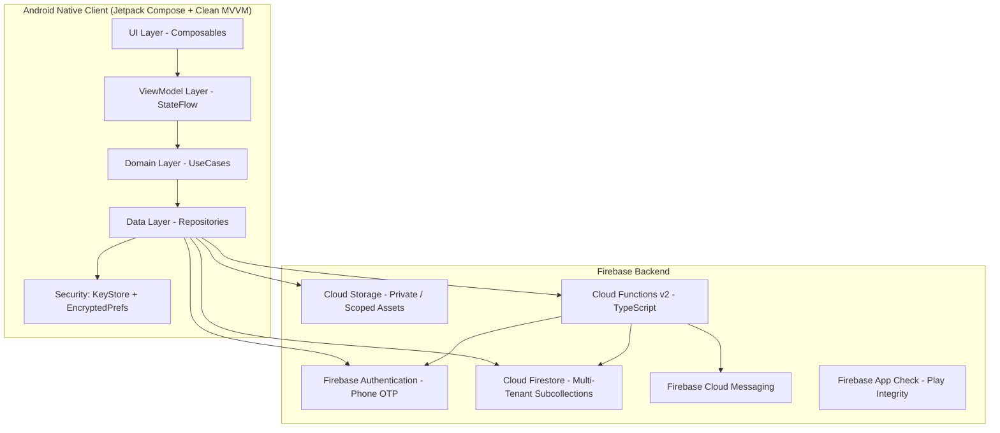
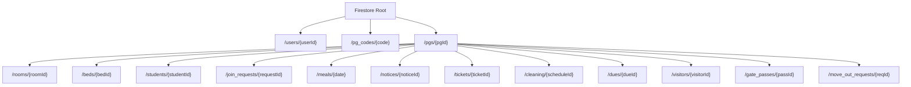

# PG Manager - System Architecture and Technical Design

## 1. System Overview

PG Manager is a multi-tenant property management platform designed specifically for Paying Guest (PG) accommodations, co-living hostels, and student residences. The system is split into two primary roles:
1. **Owner Interface**: Allows property owners to register and manage multiple PG properties, configure rooms and beds, approve or reject student join requests, publish menus and notices, manage maintenance tickets, track housekeeping, bill rent, and view financial and occupancy reports.
2. **Student Interface**: Provides verified residents with access to daily meals and meal skip requests, maintenance ticket creation, rent dues and UPI payment details, gate pass requests, notices, house rules, and room details.

The platform is designed to support thousands of independent PGs with complete tenant isolation, robust offline capabilities, and zero trust on client-supplied roles.



---

## 2. Multi-Tenant Isolation Model

Tenant isolation is implemented hierarchically under the `/pgs/{pgId}` path. No PG can read or modify another PG's data.

### Hierarchy
- `/users/{userId}`: Global user profile (role, basic KYC, phone, assigned PG references).
- `/pgs/{pgId}`: Root property document containing PG metadata, verification status, contact details, and location.
- `/pgs/{pgId}/rooms/{roomId}`: Physical room definitions (floor, room number, sharing type).
- `/pgs/{pgId}/beds/{bedId}`: Individual bed inventory with status (`VACANT`, `BOOKED`, `NOTICE_PERIOD`) and current student pointer.
- `/pgs/{pgId}/students/{studentId}`: Active and past PG residents with room/bed assignments, check-in dates, and KYC links.
- `/pgs/{pgId}/join_requests/{requestId}`: Pending student applications awaiting owner review (expires in 24 hours).
- `/pgs/{pgId}/meals/{date}`: Daily meal timings, weekly templates, meal items, and student opt-outs.
- `/pgs/{pgId}/notices/{noticeId}`: Broadcast notices and announcements.
- `/pgs/{pgId}/tickets/{ticketId}`: Maintenance and repair requests with photo attachments and assignees.
- `/pgs/{pgId}/cleaning/{cleaningId}`: Room and common area housekeeping schedules and logs.
- `/pgs/{pgId}/dues/{dueId}`: Monthly rent invoices, UPI payment details, payment receipts, and late fees.
- `/pgs/{pgId}/visitors/{visitorId}`: Guest and visitor gate logs.
- `/pgs/{pgId}/gate_passes/{passId}`: Late entry and night out requests.
- `/pgs/{pgId}/move_out_requests/{requestId}`: Notice period and move-out requests.
- `/pg_codes/{code}`: Global lookup table mapping unique PG invite codes to `pgId` with rate limiting and lock attributes.



---

## 3. Data Schema Specifications

### 3.1 `/users/{userId}`
- `userId`: string (Firebase Auth UID)
- `phoneNumber`: string (E.164 format, verified via phone OTP)
- `email`: string? (optional)
- `fullName`: string (max 100 chars)
- `role`: string (`owner` | `student` | `unassigned`)
- `profilePhotoUrl`: string?
- `address`: string?
- `idProofUrl`: string? (private storage path)
- `fcmToken`: string?
- `ownedPgIds`: array of strings (for owners, list of managed PGs)
- `activePgId`: string? (current active PG for student or currently viewed PG for owner)
- `createdAt`: timestamp
- `updatedAt`: timestamp

### 3.2 `/pgs/{pgId}`
- `pgId`: string (unique identifier)
- `ownerId`: string (userId of owner)
- `name`: string (e.g. "Sunrise Residency")
- `code`: string (e.g. "SUNRISE-4F9K2")
- `codeCreatedAt`: timestamp
- `gstNumber`: string? (15-character format)
- `gstVerificationStatus`: string (`NOT_SUBMITTED` | `PENDING` | `VERIFIED` | `FAILED`)
- `type`: string (`BOYS` | `GIRLS` | `CO_LIVING`)
- `contactPhone`: string
- `address`: string
- `latitude`: number
- `longitude`: number
- `amenities`: array of strings (Wi-Fi, AC, Geyser, RO Water, CCTV, Washing Machine, Power Backup, Gym)
- `rules`: array of strings (Curfew 10:00 PM, No smoking, Visitor entry restricted to lounge)
- `photos`: array of strings (Storage download URLs)
- `securityDepositRules`: string
- `noticePeriodDays`: number (e.g. 30)
- `electricityBillingMode`: string (`INCLUDED` | `SPLIT_PER_ROOM` | `METERED_PER_UNIT`)
- `wifiDetails`: map (`ssid`: string, `password`: string)
- `curfewTime`: string (e.g. "22:30")
- `emergencyContacts`: array of maps (`name`: string, `role`: string, `phone`: string)
- `nearbyLandmarks`: array of strings
- `upiId`: string? (e.g. "owner@okaxis")
- `upiQrImageUrl`: string?
- `createdAt`: timestamp
- `updatedAt`: timestamp

### 3.3 `/pgs/{pgId}/rooms/{roomId}`
- `roomId`: string
- `roomNumber`: string (e.g. "101")
- `floor`: number (e.g. 1)
- `sharingType`: string (`SINGLE` | `DOUBLE` | `TRIPLE` | `FOUR_PLUS`)
- `totalBeds`: number (1, 2, 3, etc.)
- `rentPerBed`: number (INR)
- `depositPerBed`: number (INR)
- `hasAttachedBathroom`: boolean
- `hasAirConditioner`: boolean
- `createdAt`: timestamp
- `updatedAt`: timestamp

### 3.4 `/pgs/{pgId}/beds/{bedId}`
- `bedId`: string
- `roomId`: string
- `roomNumber`: string
- `bedIdentifier`: string (e.g. "101-A", "101-B")
- `status`: string (`VACANT` | `BOOKED` | `NOTICE_PERIOD`)
- `currentStudentId`: string? (userId of assigned student)
- `currentStudentName`: string?
- `noticeEndDate`: timestamp?
- `updatedAt`: timestamp

### 3.5 `/pgs/{pgId}/students/{studentId}`
- `studentId`: string (userId)
- `fullName`: string
- `phoneNumber`: string
- `collegeOrWorkplace`: string
- `homeCity`: string
- `guardianName`: string
- `guardianPhone`: string
- `idProofUrl`: string
- `roomId`: string
- `roomNumber`: string
- `bedId`: string
- `bedIdentifier`: string
- `monthlyRent`: number
- `securityDeposit`: number
- `checkInDate`: timestamp
- `checkOutDate`: timestamp?
- `status`: string (`ACTIVE` | `ON_NOTICE` | `CHECKED_OUT`)
- `depositRefunded`: boolean
- `depositRefundAmount`: number?
- `createdAt`: timestamp

### 3.6 `/pgs/{pgId}/join_requests/{requestId}`
- `requestId`: string
- `studentId`: string (userId)
- `fullName`: string
- `phoneNumber`: string
- `age`: number
- `collegeOrWorkplace`: string
- `homeCity`: string
- `guardianName`: string
- `guardianPhone`: string
- `idProofUrl`: string
- `status`: string (`PENDING` | `APPROVED` | `REJECTED` | `EXPIRED`)
- `assignedRoomId`: string?
- `assignedBedId`: string?
- `rejectionReason`: string?
- `createdAt`: timestamp
- `expiresAt`: timestamp (strictly `createdAt + 24 hours`)
- `reviewedAt`: timestamp?

### 3.7 `/pgs/{pgId}/meals/{date}`
- `date`: string (YYYY-MM-DD, e.g. "2026-10-21")
- `breakfast`: map (`time`: "07:30 - 09:30", `items`: ["Idli", "Sambar", "Chutney", "Tea/Coffee"])
- `lunch`: map (`time`: "12:30 - 14:30", `items`: ["Rice", "Dal Tadka", "Paneer Butter Masala", "Roti", "Curd"])
- `snacks`: map (`time`: "17:00 - 18:00", `items`: ["Samosa", "Tea"])
- `dinner`: map (`time`: "20:00 - 22:00", `items`: ["Jeera Rice", "Dal Makhani", "Mixed Veg", "Roti", "Gulab Jamun"])
- `isHolidayMenu`: boolean
- `optOutStudentIds`: array of strings (students skipping today's meals)
- `feedback`: array of maps (`studentId`: string, `rating`: number 1-5, `comment`: string, `mealType`: string)

### 3.8 `/pgs/{pgId}/notices/{noticeId}`
- `noticeId`: string
- `title`: string
- `content`: string
- `category`: string (`GENERAL` | `FOOD` | `MAINTENANCE` | `RULES` | `EMERGENCY`)
- `isPinned`: boolean
- `authorId`: string
- `createdAt`: timestamp

### 3.9 `/pgs/{pgId}/tickets/{ticketId}`
- `ticketId`: string
- `studentId`: string
- `studentName`: string
- `roomNumber`: string
- `category`: string (`PLUMBING` | `ELECTRICAL` | `CARPENTRY` | `CLEANING` | `APPLIANCE` | `OTHER`)
- `title`: string
- `description`: string
- `photoUrls`: array of strings
- `status`: string (`OPEN` | `IN_PROGRESS` | `RESOLVED`)
- `assignedTo`: string?
- `resolutionNotes`: string?
- `createdAt`: timestamp
- `resolvedAt`: timestamp?

### 3.10 `/pgs/{pgId}/dues/{dueId}`
- `dueId`: string
- `studentId`: string
- `studentName`: string
- `roomNumber`: string
- `month`: string (e.g. "October 2026")
- `amount`: number
- `lateFee`: number
- `totalAmount`: number
- `dueDate`: timestamp
- `status`: string (`UNPAID` | `PARTIALLY_PAID` | `PAID` | `OVERDUE`)
- `amountPaid`: number
- `paidAt`: timestamp?
- `paymentMode`: string? (`UPI` | `CASH` | `BANK_TRANSFER`)
- `transactionReference`: string?
- `receiptUrl`: string?
- `notes`: string?
- `createdAt`: timestamp

### 3.11 `/pg_codes/{code}`
- `code`: string (slug + HMAC suffix, e.g. "SUNRISE-4F9K2")
- `pgId`: string
- `pgName`: string
- `ownerId`: string
- `createdAt`: timestamp
- `failedAttempts`: number
- `isLocked`: boolean
- `lockExpiresAt`: timestamp?

---

## 4. Live Capacity Calculation (No Count Drift)

To ensure bed capacity numbers never drift out of sync with concurrent writes, total capacity, occupied beds, vacant beds, and notice-period beds are calculated by querying the `/pgs/{pgId}/beds` collection rather than updating denormalized counters that can desynchronize during failed network calls or partial updates.

```kotlin
// Example query for live counts
val bedsFlow = firestore.collection("pgs").document(pgId)
    .collection("beds")
    .snapshots()
    .map { snapshot ->
        val total = snapshot.size()
        val booked = snapshot.documents.count { it.getString("status") == "BOOKED" }
        val vacant = snapshot.documents.count { it.getString("status") == "VACANT" }
        val notice = snapshot.documents.count { it.getString("status") == "NOTICE_PERIOD" }
        CapacitySummary(total = total, booked = booked, vacant = vacant, onNotice = notice)
    }
```

---

## 5. Security Architecture

1. **Deny-by-Default Firestore and Storage Rules**: Every operation requires explicit authentication, role validation, and tenant membership checks.
2. **Server-Side Custom Claims**: Roles (`role: 'owner' | 'student'`, `pgId: string`, `ownedPgIds: string[]`) are granted exclusively by Cloud Functions after verification. Clients cannot alter their claims.
3. **App Check with Play Integrity**: All Cloud Functions and Firebase resources reject requests that lack valid Play Integrity device attestations.
4. **GST Verification Adapter**: GST numbers are validated client-side and server-side using the 15-character checksum algorithm:
   $$\text{Checksum} = \left(36 - \left(\sum_{i=1}^{14} \text{factor}_i \times \text{val}(c_i)\right) \pmod{36}\right) \pmod{36}$$
   A swappable adapter interface is provided in Cloud Functions with the API key stored in Google Cloud Secret Manager.
5. **HMAC-Derived Invite Codes**:
   $$\text{Code} = \text{Slug}(\text{Name}) + \text{"-"} + \text{Base32}(\text{HMAC-SHA256}(\text{Phone}, \text{Secret}))[0..4]$$
   Prevents phone number exposure while ensuring determinism and uniqueness.
6. **Encrypted Local Storage**: Sensitive auth credentials, tokens, and active session identifiers are stored using `EncryptedSharedPreferences` backed by the Android Keystore.
7. **R8 / ProGuard and FLAG_SECURE**: Release builds enable R8 code shrinking and resource minification. Screens displaying financial dues, UPI QR codes, and government KYC documents enforce `FLAG_SECURE` to block screenshots and screen recording.

---

## 6. Cost and Scaling Note

- **Read / Write Efficiency**:
  - Each PG operates within its subcollections. Loading a PG dashboard reads only documents within that PG's subcollections.
  - Queries are capped and paginated using `limit(20)` and `startAfter(lastVisibleDoc)`.
  - Offline cache reduces repeat reads: notices, room configs, and daily meal plans are read from local cache if unchanged.
- **Projected Daily Costs for 1,000 PGs (Average 25 Students per PG = 25,000 Daily Active Users)**:
  - Firestore Reads: ~25,000 users $\times$ 15 reads/day = 375,000 reads/day $\approx$ \$0.06 / day (\$1.80 / month).
  - Firestore Writes: ~25,000 users $\times$ 2 writes/day = 50,000 writes/day $\approx$ \$0.09 / day (\$2.70 / month).
  - Storage: ID proofs and photos compressed to $\le 300\text{ KB}$. 25,000 students $\approx$ 7.5 GB storage (\$0.19 / month).
  - Cloud Functions: 50,000 invocations/day falls well within the free tier (2,000,000/month free).
  - Total operational backend cost: $<\$10\text{ USD}$ per month for 25,000 active students and 1,000 PG properties.
